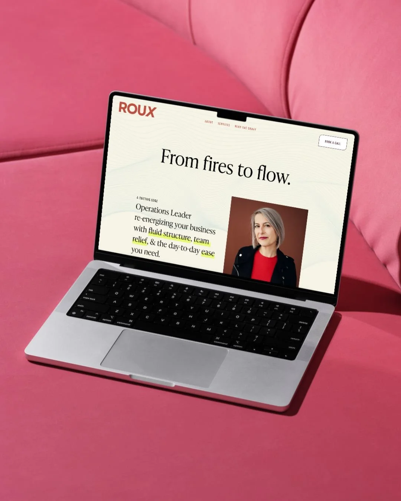
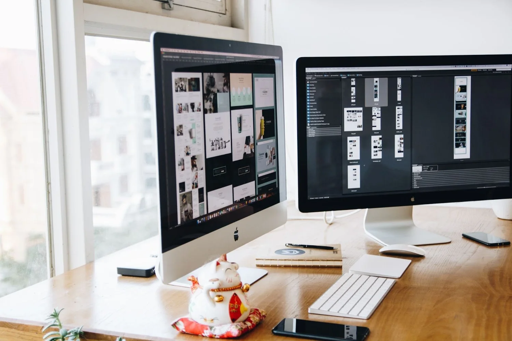

*This is a guest post written by* [*Jade Pruett from HelloSEO*](https://helloseo.com)*. Check her out!*

There is a lot to consider when creating a new website. From layouts, color, copy, and appealing to your ideal client it can be an overwhelming experience. Luckily, we have people like Emily who can do all of the heavy lifting for us, so we can confidently show up and convert the customers we want. However, another big thing to consider when creating a new website is simply that: how you actually show up. After you have invested in a beautiful rebrand, having a steady stream of people coming to your website is vital. A brand doesn't mean much if nobody sees it!

Emily has thought of everything when it comes to creating a new website, including bringing me on board to help [optimize her clients' websites for SEO](/blog/how-to-optimize-your-new-website-for-seo). To help you understand how we collaborate, I've created this quick guide to show you everything we consider when optimizing your website.

## When Do We Optimize Your Site?

Emily and I meet twice during the process of your rebrand. We meet early on to discuss your vision for your website and identify the best keywords and SEO strategy to build your website around. Then we meet again right before launch. The second meeting is all about making sure everything is in place before your website goes live and all analytics tools are set up to start tracking from the start. This way, you get optimization baked into the creation of your website, and your site is given a final seal of approval before going live.

## Why Do We Optimize Your Site Before Launch?

While there is a lot of SEO optimization that can happen on a live website, getting started before launch is a great opportunity to make sure things are structured perfectly for optimal success in Google. By starting at the very beginning, we can make sure the site is built in a way that Google can easily understand, and none of the aesthetic choices or copy have to be changed later to fit in the right keywords.

## What We Consider When Optimizing Your Website For SEO

To give you a better idea of everything that goes into each website, here is a quick list of the things we consider and discuss when optimizing each client's website:

1. ### HTML Structure

This refers to the way your website looks to Google. Google reads the code behind your beautiful website, so we want to make sure it is optimized in a way where Google can easily understand what your website is all about. This will help you rank for the right keywords as fast as possible.

In simple terms, this means making sure that your header one (H1) is optimized for your target keyword on every single page. Then, your supplemental keywords are in header two (H2) tags. The hierarchy goes from there. This is one of those things that you never typically see, but it can make a huge difference for your website.

2. ### Keyword Rankability

It is very important for us to select the right keywords to optimize your website for. And because a lot of the websites Emily creates are brand new, we don't want to optimize your site for keywords that are going to be too difficult for you to rank for early on.

During the process of keyword research, we look at keyword volume, or how many people are searching for that keyword each month, how difficult that keyword is going to be to rank for, and what the user's intent is when searching for it. This way, we can find a keyword that you can rank for quickly, and also has the intent of someone who is looking to buy from you. This is the best way to get a quick ROI on your SEO investment while also being able to build your SEO over time to be able to rank for more difficult and more profitable keywords.

3. ### Meta Titles and Descriptions

In addition to making sure your keywords are in your HTML correctly, we also want to make sure that your keywords are listed in your meta titles and descriptions. These are the bits of text that show up in Google searches. So once again, they help Google and users understand what your website is all about and help you show up better in search. And once you're in search, they can also help you get more clicks from the people who are seeing you in those searches.

  

4. ### Google Analytics Setup

With any new website, it is very important to set up Google Analytics so you are tracking data from the very beginning. Even if you're not planning on looking at it right away, it's great to have running in the background and collecting data just in case you or someone who is helping you with your business wants to reference it later.

Google Analytics will tell you what kind of traffic you're getting to your website and where it's coming from, and it will also let you know how people are behaving once they get to your website. This is a great way to know what type of content is serving you best and where your best customers are coming from so you can invest more in those marketing channels.

5. ### Google Search Console Setup

Google Search Console is one more tool that I always recommend people set up. It's completely free and it will tell you everything you need to know about your SEO. It will tell you what searches you are showing up in and which ones are resulting in clicks for you. It will also let you know if there's anything that Google wants you to change about your website so that it will index you better or even higher in searches. This is another great tool to have set up even if you never plan on looking at it.

6. ### Image ATL Text

Images hold a lot of power for SEO. They aren't just beautiful on your website, but they also help with accessibility and with helping your images show up in different types of Google searches. So making sure that you have optimized alternative text on each image on your website where appropriate is an important step that we prioritize when optimizing your website.

7. ### Image Size

The size of your images can cause major issues on your website if not addressed. When necessary, images should be compressed so that they don't make your website load too slowly. Google wants to send people to websites that offer a good user experience, and if your website is loading too slowly, people could get bored, think that your website is spammy, or just bounce and try to go somewhere else. That's why it is important to prioritize image size, which is one of the main reasons that these issues come up on smaller websites.

   

8. ### Site Speed

Speaking of site speed, checking other common speed traps on websites is an important part of our discussion for every website we work on together. Images, videos, and even unused JavaScript can cause websites to load slower than they need to. It's always important to keep site speed in mind when making changes to your site and especially if we are building a site from scratch.

9. ### Site Structure

The structure of your site is another thing to consider when building a website. The structure of your site and making sure that pages are linked appropriately can help Google better crawl your website, meaning more of your pages will get indexed easier.

10. ### URL Structure

Even the way your URLs are written can have a big effect on your SEO. It's important to use the space after your domain name to explain to Google what each page is about and utilize keywords, and it's one more place to put your target keywords. This is a very important thing to do from the very beginning because once a URL is created, it is typically a bad idea to change it because you might lose some serious SEO progress.

## What Should I Do to Keep the Optimization Going?

The work that Emily and I do together before your website is launched can do wonders for your SEO. But of course, it's just the beginning. Once your website is live, creating content, gathering backlinks, and continuing to optimize pages for Google are all important parts of building a solid foundation for your SEO and getting those new customers in the door. To learn more about what you can do to continue to optimize your new website, [check out this guide](/blog/how-to-optimize-your-new-website-for-seo).

## Let Me Know How I Can Help!

I absolutely love getting to partner with Emily to build incredible websites for her clients. I love that Emily prioritizes not just beautiful websites, but websites that are technically sound and will work as a powerful marketing tool for their owners. If you have any questions about how your website has been optimized for SEO, feel free to [reach out](https://helloseo.com/contact) to me. I'm always happy to lend a hand!
