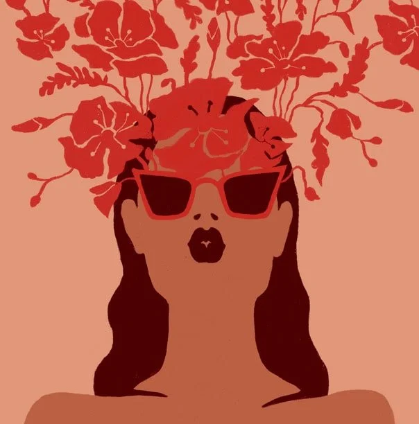
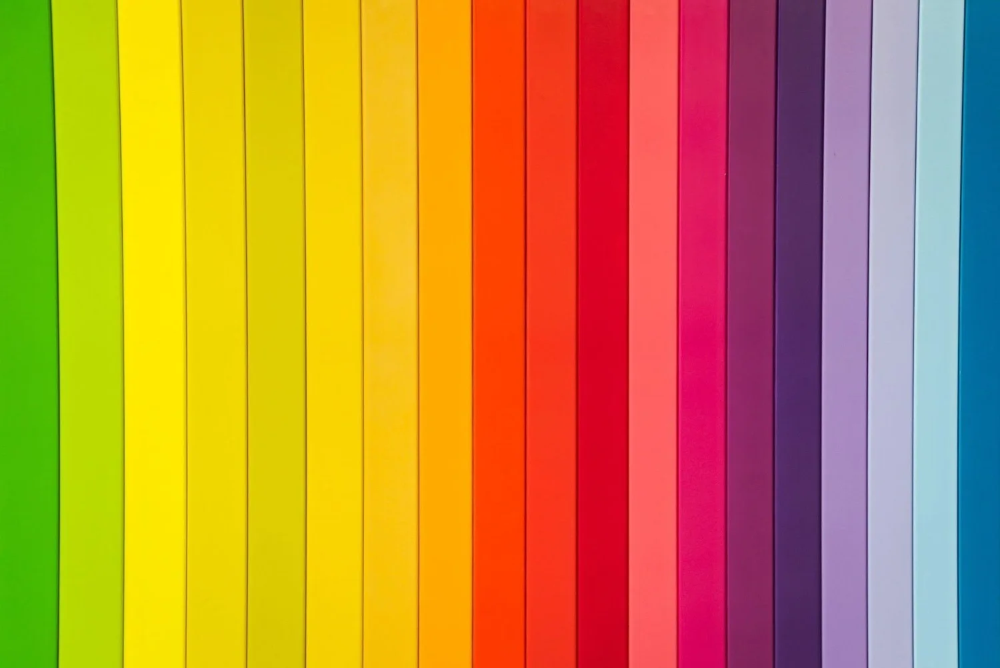

This blog is a part of my [Ultimate Guide to Rebranding.](/blog/rebranding) Check it out for more info!

Ever paused to consider why you gravitate towards certain colors? Or why specific hues evoke particular emotions? The science of color psychology delves into these very questions, and for businesses, it's an instrumental tool that goes beyond mere aesthetics.

## Why Color Choices Matter

Many businesses, especially those in their infancy, often select brand colors based on personal preferences or trending styles on platforms like Pinterest. While these reasons might resonate with the founder, they might not resonate with the audience. After all, your customers won't know the sentimental story behind your grandma's favorite shade of blue. They'll react to your brand's colors based purely on their emotional and psychological responses.

## Crafting Your Brand's Color Story Through Emotions

The key to an impactful brand palette isn't just selecting 'attractive' colors. It's about understanding and harnessing the emotions those colors stir in your audience. For instance, certain colors can evoke feelings of trust, excitement, calmness, or urgency. By aligning your brand's mission and values with the right hues, you can guide your audience's emotions in the direction you want. The question is: What feelings do you want to ignite in someone encountering your brand for the first time?

## The Science Behind the Shade

Though it might sound lofty, the emotional power of colors is grounded in numerous studies. Professionals across industries, be it interior design, fashion, or marketing, leverage color psychology. They aren’t merely choosing colors they ‘like’ but are making calculated choices based on how those colors influence perceptions and behaviors.

## Brand Books & Color Choices

In the brand books I craft for clients, I ensure that each color is chosen with intent. For example, a specific shade of cream might be selected because it conveys feelings of spaciousness and refreshment. It’s essential to document the rationale behind each hue to keep branding decisions aligned and purposeful.

## The True Power of Color

When done right, your brand’s color palette becomes more than just visually appealing. It turns into a strategic tool that shapes perceptions, sets expectations, and drives desired actions. As you design or refine your brand's visual identity, remember to look beyond the surface and dive into the rich world of color psychology.

## The Hidden Influence of Color Psychology

Color is more than what meets the eye; it's a potent tool that can influence emotions, behaviors, and perceptions. Whether you're starting a new business or looking to revamp your brand, understanding the psychology of color can be the key to connecting with your audience on a deeper level and driving business success.

## Choosing Colors with Purpose

When selecting colors for your brand, it's not enough to pick what you personally find appealing or what's trending. Instead, think about the emotions and associations each color evokes. For example, blue often conveys trust and reliability, while red can evoke excitement and urgency. By choosing colors that align with your brand's mission and values, you can strategically guide your audience's emotions.

## The Scientific Backing

The power of color psychology isn't just anecdotal; it's backed by scientific research. Professionals in various industries, from interior design to fashion and marketing, leverage these insights to make informed color choices. They understand that color isn't just about aesthetics. It's a powerful tool for shaping perceptions and behaviors.

## Documenting Your Color Choices

In the world of branding, consistency is key. That's why brand books, which detail every aspect of a brand's visual identity, including color choices, are essential. When you document the rationale behind each color in your brand palette, you ensure that branding decisions remain purposeful and aligned with your brand's goals.

## Unlocking the True Power of Color

When you use color psychology effectively in your branding, your brand's color palette becomes more than just visually appealing- it becomes a strategic asset. It sets the tone for your brand, influences how your audience perceives you, and even drives them to take desired actions. As you embark on the journey of designing or refining your brand's visual identity, remember to explore the rich world of color psychology. It's not just about what looks good. It's about what works to create a deeper connection with your audience and ultimately drive your business's success.

Color psychology is a dynamic force that should not be underestimated in the world of branding. It's not just about selecting visually appealing shades but about strategically using colors to evoke emotions, shape perceptions, and drive desired actions. By understanding the science behind color choices and documenting the rationale for each hue in your brand palette, you can ensure consistency and purpose in your branding efforts. Ultimately, harnessing the emotional power of color can be the key to establishing a deep connection with your audience and driving the success of your business. Choose your colors wisely and let them convey the essence and values of your brand in a way that resonates with your target audience.

## ABOUT EMILY:

 Hi, I'm Emily! Welcome to a one-stop shop for your bespoke brand experience.

Why care what I say? Good question.&nbsp; I have 14 years of brand development and marketing experience with a range of brands including [Abercrombie & Fitch](https://corporate.abercrombie.com/), [The Wendy's Company](https://www.wendys.com/who-we-are) and scrappy-to-successful start-ups. As a Brand Manager, Visual Designer, Marketing Director and certified UX Designer, (brag) I've honed the ability to identify owner brilliance, articulate unique value and build swoon-worthy brands that move businesses forward.   I started Electric Collab in 2021 to help talented entrepreneurs expand their business potential with an authentic brand that amplifies the incredible quality of their work. Thank you for reading - I am so glad you're here.
