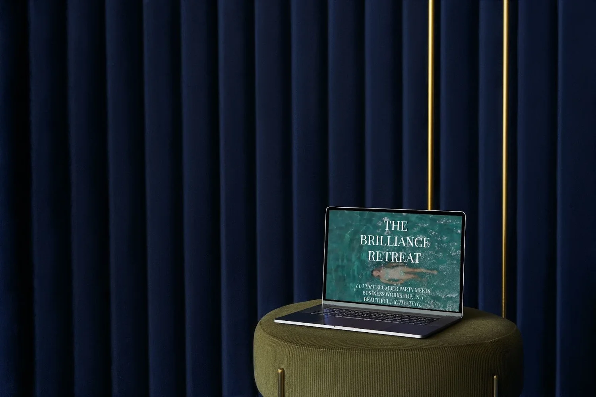

This blog is a part of my [Ultimate Guide to Rebranding](/blog/rebranding). Check it out for more info!

User Experience (UX) might sound like a buzzword to many, but to website developers and designers, it’s a pivotal concept that transforms an ordinary website into an engaging, interactive, and user-friendly platform. As a certified UX designer turned website developer, I believe I bring a unique touch to my projects, combining the beauty of design with the functionality of UX principles. In this blog post we’ll delve deeper into what exactly UX is, and more importantly, how UX can help you and your business.

## What is UX?

User Experience (UX) is the study and art of crafting how users interact with and perceive a product or service. While it might seem digital-focused, UX principles can apply to everything - from a website to the ergonomic design of a chair or even the packaging of your favorite snack. It's about ensuring a product, digital or physical, provides the most intuitive, engaging, and user-friendly experience. The aim is to evoke positive emotions, ensuring users feel validated, included, and most importantly, valued.

## The Importance of UX in Digital Spaces:

When it comes to websites, UX design addresses questions like:

How quickly does the site load?

Is the content easy to navigate?

Are the calls-to-action clearly visible and compelling?

Does the design resonate emotionally with the target audience?

In essence, a UX designer wears the shoes of the end user, ensuring every click and scroll feels natural, logical, and rewarding.

## Bridging the Gap - From UX Principles to Web Development

Having a background in UX has allowed me to approach web development with a broader perspective. Rather than just focusing on the aesthetics or the backend code, I can strike a balance, ensuring the website is not only visually appealing but also user-centric.

## Storytelling

The art of UX is akin to storytelling. A well-designed website should lead users on a journey, introducing them to the brand, its values, products, or services, and guiding them to the desired action, whether that's signing up, purchasing, or simply learning more.

## Emotional Design

Users should feel a connection. With my knowledge of UX, I ensure that every design choice, from color palettes to typography, evokes the right emotions, aligning with the brand’s values and resonating with the target audience.

## Feedback & Iteration

The UX design process heavily emphasizes feedback. Post-launch, I monitor user interactions, gathering insights to refine and iterate the website design and ensuring it continually meets users' evolving needs.

## Inclusivity

One critical aspect of UX is designing for all. This means ensuring websites are accessible to everyone, including those with disabilities. It's about ensuring no potential user or customer feels left out.

While the intricacies of UX might seem foreign to many outside the digital space, it’s a crucial tool in my web development arsenal. It’s not about jargon or buzzwords. It's about putting the user first, ensuring their digital journey is as seamless, enjoyable, and engaging as possible. In an online world bursting with websites vying for attention, a solid UX foundation might just be the secret sauce that sets a brand apart.

## ABOUT EMILY:

 Hi, I'm Emily! Welcome to a one-stop shop for your bespoke brand experience.

Why care what I say? Good question.&nbsp; I have 14 years of brand development and marketing experience with a range of brands including [Abercrombie & Fitch](https://corporate.abercrombie.com/), [The Wendy's Company](https://www.wendys.com/who-we-are) and scrappy-to-successful start-ups. As a Brand Manager, Visual Designer, Marketing Director and certified UX Designer, (brag) I've honed the ability to identify owner brilliance, articulate unique value and build swoon-worthy brands that move businesses forward.   I started Electric Collab in 2021 to help talented entrepreneurs expand their business potential with an authentic brand that amplifies the incredible quality of their work. Thank you for reading - I am so glad you're here.
