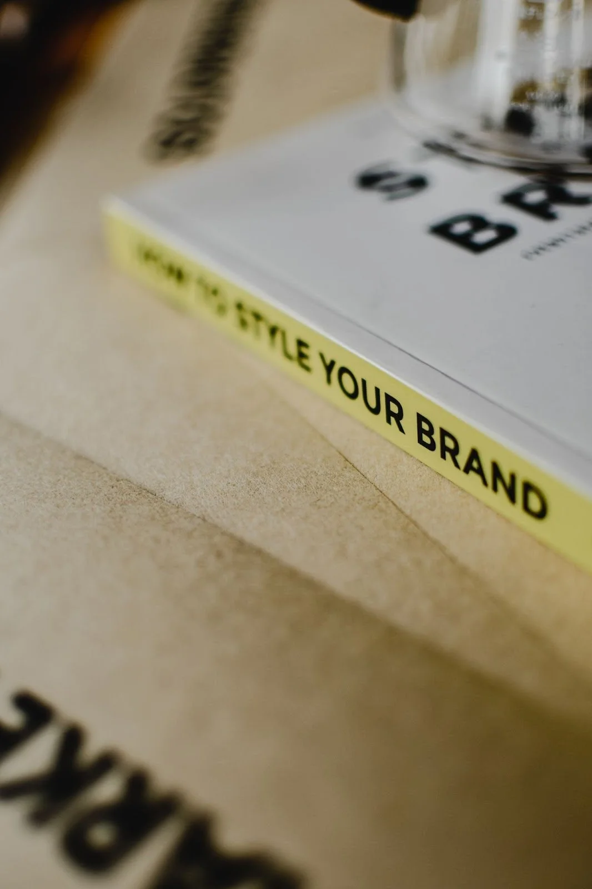

This blog is a part of my [Ultimate Guide to Rebranding](/blog/rebranding). Check it out for more info!

The concept of branding often gets reduced to just logos and catchy taglines. But let’s be real; it’s much more layered than that. Peel back the veneer, and you'll find a world of visual identity and digital presence waiting to be explored. These aren't just fancy terms thrown around in marketing meetings. They're crucial components that define how the world perceives your brand.

## What is Visual Identity?

When someone mentions "Visual Identity," it's natural to think of logos, colors, or fonts. In the world of branding, visual identity serves as the recognizable face of your brand. Imagine bumping into me, Emily, at your favorite coffee shop. A quick glance and you think, "Ah, that's Emily!" That instant recognition is precisely the magic a solid visual identity achieves. It goes beyond aesthetics. It’s about the primary logo, the alternate logo, the color palette, and typography. These elements aren’t just for show. They become the consistent "face" people resonate with when they think of your brand.

## What is Digital Presence?

If you thought digital presence was just another name for a website, think again. This term encompasses everything digital associated with your brand. We're talking social media like Instagram and LinkedIn, guest blog posts, podcast appearances, and more. Every piece of content, every mention, every share contributes to your brand's digital narrative. It's about creating an impactful presence in a vast digital universe. And given how jam-packed the online world is today, tools like SEO become crucial. They're not just add-ons; they’re the megaphones amplifying your brand voice.

## Why Visual Identity and Digital Presence Are Both Important for Your Business

While visual identity and digital presence often get wrapped up under the broad term 'branding', they play different, yet complementary roles. They're like two sides of the same coin. Visual identity is the face, the immediate recognition, while digital presence is the voice, the ongoing conversation with your audience. Merging them into one term doesn't do justice to their unique impact. It’s important to recognize their distinct influence in building a memorable brand.

## Visual Identity: The Face of Your Brand

Think of visual identity as the face of your brand. It's the first thing people notice, and it leaves a lasting impression. Your logo, whether it's the primary one or an alternate version, is like your brand's signature. It's how your audience recognizes you amidst the digital noise. The color palette you choose isn't just about aesthetics; it's about conveying emotions and associations. And don't underestimate the power of typography – it sets the tone for your brand's personality.

But visual identity is more than just visuals- it's consistency. It's about ensuring that every visual element is aligned, from your website to your social media profiles, business cards, and even packaging. This consistency builds trust and reinforces your brand's identity in the minds of your audience.

## Digital Presence: The Voice of Your Brand

Now, let's talk about digital presence – the voice of your brand. It's not confined to your website; it extends to every digital platform where your brand exists. Social media is a major player here. Your posts, stories, and interactions on platforms like Instagram and LinkedIn shape your digital identity. But it doesn’t stop there. Guest blog posts, podcast appearances, online reviews, and even the way you respond to customer inquiries – they all contribute to your digital presence.

In the digital landscape, being discoverable is essential. This is where search engine optimization (SEO) comes into play. It's not just a technicality; it's your brand's ticket to being found among the billions of online pages.

In the world of branding, visual identity and digital presence are not interchangeable terms. They are two distinct pillars, each playing a vital role in shaping your brand's perception and impact. Visual identity is your brand's face, the immediate recognition factor that creates trust and consistency. Digital presence, on the other hand, is your brand's voice, the ongoing conversation with your audience that expands your reach and influence.

So, the next time you embark on a branding journey, remember to give due importance to both of these components. Your logo and color palette are just as significant as your social media strategy and SEO efforts. Together, visual identity and digital presence create a harmonious symphony that resonates with your audience, making your brand memorable and impactful in the ever-evolving digital landscape.

## ABOUT EMILY:

 Hi, I'm Emily! Welcome to a one-stop shop for your bespoke brand experience.

Why care what I say? Good question.&nbsp; I have 14 years of brand development and marketing experience with a range of brands including [Abercrombie & Fitch](https://corporate.abercrombie.com/), [The Wendy's Company](https://www.wendys.com/who-we-are) and scrappy-to-successful start-ups. As a Brand Manager, Visual Designer, Marketing Director and certified UX Designer, (brag) I've honed the ability to identify owner brilliance, articulate unique value and build swoon-worthy brands that move businesses forward.   I started Electric Collab in 2021 to help talented entrepreneurs expand their business potential with an authentic brand that amplifies the incredible quality of their work. Thank you for reading - I am so glad you're here.
