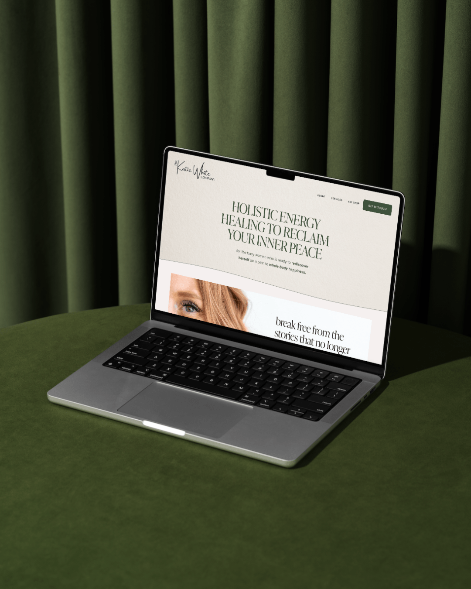

This blog is a part of my [Ultimate Guide to Rebranding](/blog/rebranding). Check it out for more info!

Considering a rebrand? It's not just about slapping on a fresh coat of paint on your website or swapping out fonts. Let's pull back the curtain on what's truly involved in this transformative process.

## 1. Laying the Groundwork of Your Brand

Imagine building a house. You wouldn't start with the roof, right? The foundation is where the magic begins. This part is critical because it doesn't change—even if you're renovating the rest. So, what does this foundation consist of?

Purpose: The core reason your brand exists.

Modern Mission: Your updated call-to-arms.

Brand Values: The core principles guiding your brand's actions.

Voice and Personality: Your brand's unique flair and tone.

Your brand's identity is not just a surface-level makeover. It's about [redefining your brand's essence](/brand-therapy) and clarifying its purpose in the world. Your purpose is your guiding star, your mission is your rallying cry, your values are your moral compass, and your voice and personality set the tone for how you engage with your audience.

## 2. Craft Your Messaging Strategy

Now that we've got the bedrock in place, let's talk about how we communicate. This phase is all about understanding your ideal client and what makes them tick.

Ideal Client Profile: Crafting a vivid image of your target audience.

Keyword Research: A recent addition to my process, ensuring you’re searchable.

Unique Value Proposition (UVP): Your brand's one-of-a-kind selling point. Like being a body-positive cosmetic surgery brand in a sea of Kardashians.

Understanding your ideal client is like finding the treasure map to your success. It allows you to tailor your messaging, products, and services to meet their needs and desires. Keyword research ensures you're discoverable in the digital landscape, and your UVP sets you apart in a crowded market.

## 3. Creating Your Visual Identity

Here's the fun part of rebranding!

Primary and Secondary Logos: Distinct symbols representing your brand.

Psychology-Based Color Palette: Not just any shade of blue. We're talking researched, emotion-evoking hues that resonate.

Typography: The fonts that complement your brand's personality.

Visual identity is the face of your brand. It's what catches the eye and leaves a lasting impression. The colors you choose can evoke emotions and convey meaning, while typography sets the tone for your brand's voice. And your logos? They are the visual symbols that make your brand instantly recognizable.

## 4. Building Your New Website

Every element from the previous steps converge here to create your brand’s online domain—a place you're thrilled to show off. This is where potential clients and customers get a feel for who you are, journeying from curious visitors to eager buyers.

Your website is more than just a virtual storefront. It's the digital hub where your brand story unfolds, where your message is amplified, and where your audience engages with your offerings. It's the culmination of all the groundwork, messaging, and visual elements working in harmony to captivate and convert.

But Wait, There's More: Deliverables!

Think of this as the cherry on top. At the end of our collaboration:

You'll own a Brand Book: An all-encompassing guide with every single detail we've chatted about. It's like the bible for your brand.

A Custom Website: Your very own corner on the internet. It's all yours, baby!

Plus, once we've partnered up on this major stuff, I can assist with other brand necessities like podcast covers, business cards, course materials, and so much more.

A rebrand is not just a surface-level makeover; it's a deep dive into your brand's essence and identity. It's about crafting a compelling narrative, a captivating visual identity, and a digital presence that resonates with your audience. So, if you're considering a rebrand, remember that it's not just about the paint; it's about the very soul of your brand.

## ABOUT EMILY:

 Hi, I'm Emily! Welcome to a one-stop shop for your bespoke brand experience.

Why care what I say? Good question.&nbsp; I have 14 years of brand development and marketing experience with a range of brands including [Abercrombie & Fitch](https://corporate.abercrombie.com/), [The Wendy's Company](https://www.wendys.com/who-we-are) and scrappy-to-successful start-ups. As a Brand Manager, Visual Designer, Marketing Director and certified UX Designer, (brag) I've honed the ability to identify owner brilliance, articulate unique value and build swoon-worthy brands that move businesses forward.   I started Electric Collab in 2021 to help talented entrepreneurs expand their business potential with an authentic brand that amplifies the incredible quality of their work. Thank you for reading - I am so glad you're here.
